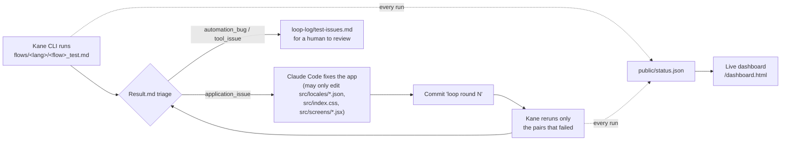

# WetinBreak Pay

**An AI agent translates an app into Nigerian Pidgin, Yoruba, Igbo and Hausa. Kane CLI checks every
flow in every language. The agent fixes what Kane finds, and the loop repeats until everything passes.**

- Live demo: https://wetinbreak.vercel.app · test dashboard (replay of a real run): https://wetinbreak.vercel.app/dashboard.html
- Demo video: `TODO: https://youtu.be/<id>`
- Launch posts: `TODO: X / LinkedIn links`

WetinBreak Pay is a small airtime and electricity-bill app ("wetin break?" is Pidgin for "what broke?").
It has 5 user flows in 5 languages, which makes 25 language/flow pairs, and each pair is a Kane CLI test.

## The loop



`npm run loop` ([scripts/loop.js](scripts/loop.js)) runs the whole cycle unattended:

1. Kane CLI runs every failing language/flow pair, one at a time.
2. The loop reads each run's `Result.md` and sorts failures by Kane's bug verdict.
3. **App issues** go to Claude Code in headless mode, with Bash and Write turned off and `Edit` limited to locale files, CSS and screens. After the fixer runs, a guard reverts anything it changed outside those paths.
4. **Test and tool issues** are never "fixed" by the agent. They are written to `loop-log/test-issues.md` for a person to look at, because a test must never be changed just to make it pass.
5. The round is committed (`loop round N: …`), and Kane reruns only the pairs that failed.
6. Every run updates `public/status.json`. The dashboard polls it every 2 seconds and shows a 5×5 grid (red, green, or pulsing amber while running) with Kane's reason on hover.

## How Kane CLI is used

- **Templates and generator.** Each flow is written once in [flows/templates/](flows/templates/) with `{{key}}` placeholders. `npm run flows:make` ([scripts/make-flows.js](scripts/make-flows.js)) fills them from each `src/locales/<lang>.json` and writes `flows/<lang>/<flow>_test.md`, pointed at `?lang=<lang>&slow=1`.
- **Exact-text checks from locale keys.** Steps say things like `Then verify the heading reads exactly "{{payment_successful}}"`, so the expected Hausa or Igbo text comes straight from the translation file. For Yoruba, Igbo and Hausa, a "no English on screen" check is added too. Pidgin is English-based, so it gets exact checks only.
- **Every action is followed by its own check**, and the "text is not cut off" checks run *before* the button is clicked, so clipped labels can't slip past.
- **The `?slow=1` hook.** Kane needs about 15 seconds to read the screen after a click, so `?slow=1` keeps the "Processing…" state on screen for 20 seconds ([src/store.js](src/store.js)). It's a test hook, not a fix.
- **Triage labels.** The loop parses Kane's verdict in `Result.md` (`[application_issue/…]` or `[automation_bug/…]`) and adds `tool_issue` for runs that produced no result or stalled.
- **Credit guard.** The loop stops at 40 Kane runs per invocation and never reruns a pair unless the app changed. `--resume` reuses results already paid for if a run was interrupted.

## Results

Numbers come from [baseline/SUMMARY.md](baseline/SUMMARY.md), [baseline-v2/SUMMARY.md](baseline-v2/SUMMARY.md) and `loop-log/runs.jsonl`.

**Baseline v1** (first, looser tests, 4 flows × 4 languages): **4 / 16 passed.**

| | signup | airtime | bill | history |
|---|---|---|---|---|
| Pidgin | FAIL | FAIL | FAIL | FAIL |
| Yoruba | PASS | FAIL | FAIL | PASS |
| Igbo | PASS | FAIL | FAIL | FAIL |
| Hausa | PASS | FAIL | FAIL | FAIL |

**Baseline v2** (tightened tests, empty-history flow added, all 5 English flows passing first): **3 / 20 passed**, or 8 / 25 counting English. All 12 app failures map to planted bugs, plus 5 test or tool issues and no false passes.

| | signup | airtime | bill | history | empty history |
|---|---|---|---|---|---|
| Pidgin | PASS | FAIL | FAIL | FAIL | FAIL |
| Yoruba | PASS | FAIL | FAIL | FAIL | FAIL |
| Igbo | PASS | FAIL | FAIL | FAIL | FAIL |
| Hausa | FAIL | FAIL | FAIL | FAIL | FAIL |

**After the loop and one round of rechecks: 25 / 25 passing** (it was 8 / 25).

| | signup | airtime | bill | history | empty history |
|---|---|---|---|---|---|
| English | PASS | PASS | PASS | PASS | PASS |
| Pidgin | PASS | PASS (R3) | PASS | PASS (R3) | PASS |
| Yoruba | PASS | PASS | PASS | PASS (R3) | PASS |
| Igbo | PASS | PASS | PASS | PASS (R3) | PASS |
| Hausa | PASS (R3) | PASS | PASS (R3) | PASS (R3) | PASS (R3) |

- **2 loop rounds (34 Kane runs) plus 8 manual rechecks.** Total: **42 runs, about 2,570 credits**.
- **Round 1** (17 runs): Claude Code fixed bugs 1 to 5 in one commit: three hardcoded strings swapped for `t('…')`, and the fixed-width/height buttons made to grow with their text.
- **Round 2** (17 runs): 9 pairs went green, leaving 18 / 25. The round-2 fixer couldn't reach the API (a network error), so the loop stopped there.
- **Bug 6** (missing Hausa `pay_bill`) needed a key *and* a test change, because the generator had built the English fallback "Pay bill" into the Hausa flows. The fixer correctly refused to touch tests, so I made both changes by hand and rechecked ha/bill once: it passed.
- **Round 3** (7 runs, 23 Nov, every one passed first time) fixed the last 7 reds outside the loop. No test was changed:
  - **A real bug Kane found on its own (yo, ha history):** timestamps showed an English "AM", because browsers have no Yoruba or Hausa date format and fall back to the English 12-hour clock. History now uses a numbers-only, day-first, 24-hour format (`23/11/2026, 21:12`).
  - **pcm airtime, pcm history, ig history:** all three failed the same check. Kane's raw log shows it compared `'📱 Buy credit'` with `'Buy credit'`: the emoji icon was part of the button's text. (For Igbo, Kane's summary wrongly blamed a missing diacritic; the locale and test strings are byte-identical.) The icon is now drawn by CSS with empty alt text, so the button's text and accessible name are just the label. That is also a real screen-reader fix.
  - **ha signup, ha empty history:** rerun after the bug 6 fix (signup had failed on "Pay bill"; empty history had last hit a Kane tool error).
- **Caveat:** the 18 pairs that were already green were not rerun after the round-3 changes. Those changes touch the Home and History screens that every flow passes through, so a full 25-pair rerun on the final build would make this result airtight.

## Honesty section

- The six bugs were **planted on purpose** so Kane had something real to find: see [KNOWN_BUGS.md](KNOWN_BUGS.md).
- **Baseline v1 caught:** bug 4 ("Payment successful" in English) and bug 6 (Hausa "Pay bill").
- **Baseline v1 missed:**
  - Bug 1 (cut-off "Back to home"): the cut-off check ran after the click.
  - Bugs 3 and 5: "Processing…" lasted one second, and History was never empty.
- **Baseline v1 false passes:** yo/history and ha/signup passed while a planted bug was on screen. Two airtime failures were real bugs that Kane blamed on its own steps.
- **How the tests were tightened for v2:**
  - Exact-text checks built from locale keys replaced the vague "is there English?" questions.
  - The language check now runs only for Yoruba, Igbo and Hausa.
  - Every action was split from its check, and cut-off checks moved to before the click.
  - The `?slow=1` hook was added.
  - A new empty-history flow was added.
- **Kane's labels are not always right.** Baseline v2 had timing misses that Kane called app bugs and agent stalls on screens that rendered fine. Every one is mapped by hand in [baseline-v2/SUMMARY.md](baseline-v2/SUMMARY.md).
- **Translations were written with AI help.** Native-speaker review:
  - `TODO (collex89): list which of pcm.json / yo.json / ig.json / ha.json a native speaker has checked, and by whom.`

## Quick start

```bash
npm install
kane-cli login
npm run dev                # app at http://localhost:5173
npm run flows:make         # regenerate flows/<lang>/ from templates + locales
npm run loop               # Kane → Claude Code → Kane until green (uses Kane credits)
# then open http://localhost:5173/dashboard.html
```

- `npm run demo:reset` creates a branch `demo-run-<timestamp>` from `demo-start`, which has all six bugs, and copies in the latest loop and dashboard so you can record a run from red to green. It never touches `main`.
- `/dashboard.html?replay=1` (or any host without a live `status.json`) plays back the real run in [public/replay.json](public/replay.json). Regenerate that file with `npm run replay:make`.
- The loop needs Kane CLI and Claude Code installed and signed in. Kane CLI costs credits per run.

## Built by

Built by **@collex89**. MIT licence, see [LICENSE](LICENSE).
